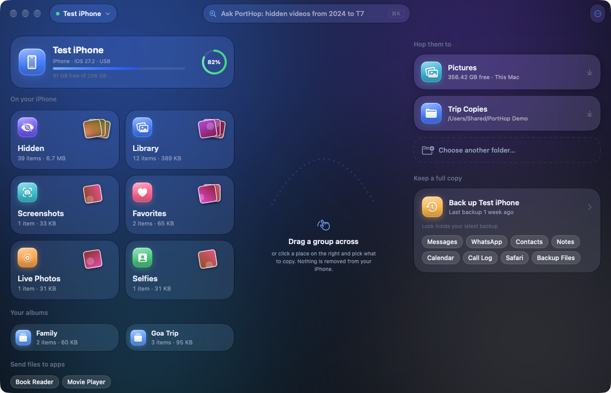
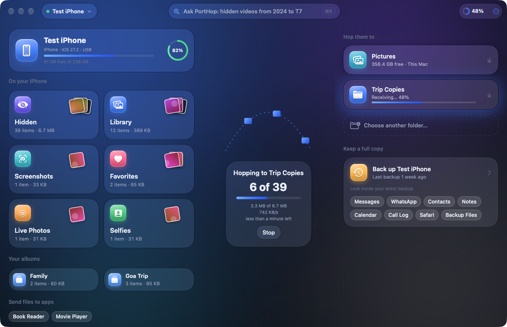
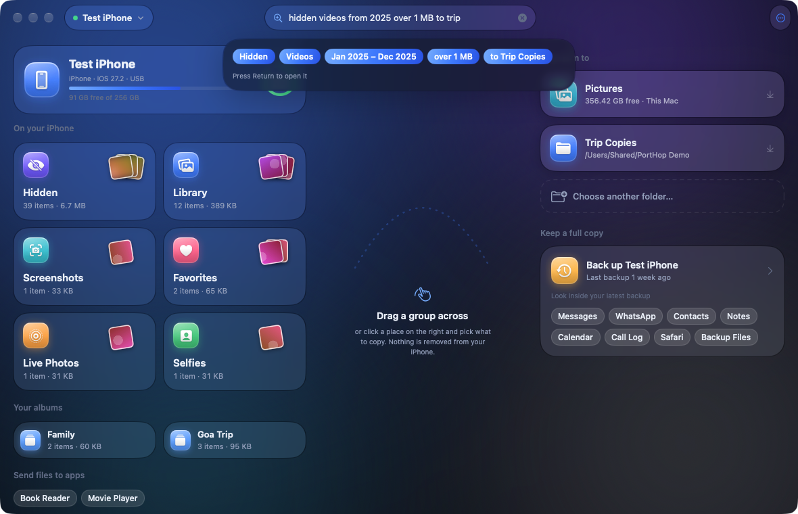

# PortHop

Copies photos, videos and files between an iPhone, iPad or Android device and a Mac (or a Windows PC, see `windows/`) over USB, to a folder or an external drive. Standalone: the device tools it needs are bundled inside the app.

Both apps follow the system's light or dark mode live, or can be fixed to either in the ⋯ menu (Appearance). On macOS 26 and later the Mac app uses Liquid Glass the way Apple's own apps do: the toolbar, buttons, the Ask panel and floating bars are glass, and content sits on quiet system surfaces. Older macOS versions get the same layout with solid surfaces. Its icons are Apple's own SF Symbols on light-catching tiles, with SF Symbols 7's gradient shading on macOS 26.

## Use it

1. Open **PortHop** (it is copied into Applications by `./build.sh --install`).
2. Plug in the iPhone, iPad or Android device, unlock it and tap **Trust** (**Allow** on Android). It appears by itself. With two devices plugged in, switch between them from the device menu at the top left.
3. **Shores** is the main screen: the device's photo groups on the left (Hidden, Library, Videos, Screenshots, your albums), places to copy them on the right (Pictures, each external drive, folders used before). Drag a group onto a place, or click a place and pick a group. The copy then hops across the middle.
4. Click a group to look inside: filter, search, drag across its month-by-month timeline to pick a stretch of time, select items, and copy just those.
5. Or type what you want into **Ask PortHop** at the top (⌘K), for example "hidden videos from 2024 over 100 MB to T7".

Copying again into the same folder is safe: files with the same name and exact size are recognised and skipped, and nothing is ever overwritten. The summary shows what was copied, what was already there and anything that couldn't be copied.

| | |
|---|---|
|  |  |
|  |  |

## External drives

Any drive the Mac can write to works (APFS, Mac OS Extended, exFAT, FAT32): pen drives, SSDs, hard disks. They show up as one-click destinations. FAT32 cannot hold files over 4 GB; the app warns before copying. NTFS drives are read-only on macOS and are shown as such.

## Device details

Click the device card on Shores, or open the device menu at the top left, for battery health and charge cycles, storage, device identifiers with Copy All, and Restart and Sleep. Screen transitions can be turned off in the settings menu (top right) or under View ▸ Animated Screen Transitions.

Hidden items appear only in **Hidden**, never in Screenshots, Favorites or other albums, matching the Photos app.

## Sending files to the device

Shores lists apps that share a folder (for example video players and document readers) under "Send files to apps". Open one to drag files in from Finder, create folders, or copy its files back to the Mac. Files dropped from Finder onto the device's side of Shores go to an app of your choice. Existing files are never overwritten. Photos cannot be added to the Photos library this way; iOS does not allow it over this connection.

## Android (beta)

With an Android phone or tablet plugged in, the app shows its shared storage (Camera, Pictures, Download, Movies and the rest): copy files and folders to the Mac, drag files in from Finder, make folders. Nothing is overwritten in either direction. Overview shows battery, storage and device details, with Restart and Sleep.

Two things are needed:

- On the phone: turn on **USB debugging** (Settings ▸ About phone ▸ tap Build number seven times, then Settings ▸ Developer options ▸ USB debugging) and tap **Allow** when the Mac is first connected.
- On the Mac: Google's `adb`. Its licence does not allow it to be shipped inside another app, so it is not bundled. Install it with `brew install android-platform-tools`, or unzip Google's platform-tools into `~/Library/Application Support/iPhoneAlbumExtractor/android/`.

Tested against a simulated phone only; not yet verified on a real Android device. There is no album view for Android yet, only folders.

## Backups (beta)

**Backups** makes a standard full device backup (the format Finder uses) into a folder or external drive of your choice; later runs only copy changes. **Restore…** on a backup puts it back onto the connected device, replacing its settings and app data; it needs Find My turned off and asks for a typed confirmation first. Neither backup nor restore has been verified on a real device yet.

## Reading a backup (beta)

**From your backup** in the sidebar reads the newest backup in the backup folder without changing it: Messages and WhatsApp conversations, Contacts, Notes (title and opening lines), Calendar, Safari bookmarks and history, and every file in the backup (Backup Files), which can be copied out under its real name. Each list can be searched and saved as a spreadsheet (CSV) file.

Password-protected (encrypted) backups are supported: the app asks for the backup password, uses it in memory only and never saves it. Decrypted working copies go to a temporary folder that is removed when the app quits. Apple only puts the call log in encrypted backups, so Call Log is empty for plain ones. Photos and attachments inside conversations are shown as a placeholder. Tested against a simulated backup with invented data only; not yet verified on a real one.

## What it does not do (yet)

- It copies each photo's **original file**. Edits made in the Photos app are not applied.
- Live Photos export as the still image unless **Include Live Photo videos** is on.
- Originals stored only in iCloud are reported as not copied.
- Wi-Fi setup is not implemented.

## Windows edition

`windows/` holds a Windows edition with the same features and the same Shores layout, dressed in Material 3 Expressive: a colour scheme generated with Google's Material colour library, Google's Material Symbols icons in shape-morphing containers, a wavy progress bar and springy motion (an Electron app, so it can be built and tested from a Mac). See `windows/README.md`. It has been tested against simulated devices only, not yet on a real Windows PC.

## iOS compatibility

The app reads the device's internal `PhotoData/Photos.sqlite`, which Apple does not document and can change in any release. The tables and columns are checked before use: optional ones degrade with a visible warning, and a missing required one stops with a clear message instead of wrong results. Verified on iOS 27.2 (iPhone 15 Pro Max).

## Build and test

- `./build.sh` builds and ad-hoc signs the app. Add `--install` to also copy it into Applications. It needs only Xcode (or its command-line tools): the iPhone tools inside the app are built from their official source by `build_tools.py` (about a minute the first time, cached afterwards).
- `Tests/run_tests.sh` runs the export engine against a simulated iPhone; no real device is touched.
- The environment variables used for automated UI checks only work in builds compiled with `-D UITEST`; normal builds ignore them.

Runs on Apple Silicon Macs with macOS 13 or later. Not notarized: on another Mac, right-click → Open the first time.

PortHop is released under the MIT licence (see `LICENSE`). The bundled open-source tools keep their own licences (GPL, LGPL, Apache); each app carries them, with a `SOURCES.txt` naming the exact source used.

## Publishing a release

`python3 make_release.py` builds everything into `release/`: the Mac app, the Windows app and `PortHop-<version>-sources.zip`. Upload all three to the same GitHub release. The GPL and LGPL licences of the bundled tools require their source to be offered from the same place as the apps, and the sources zip is that offer: PortHop's own code plus the exact source of every bundled tool and library.
