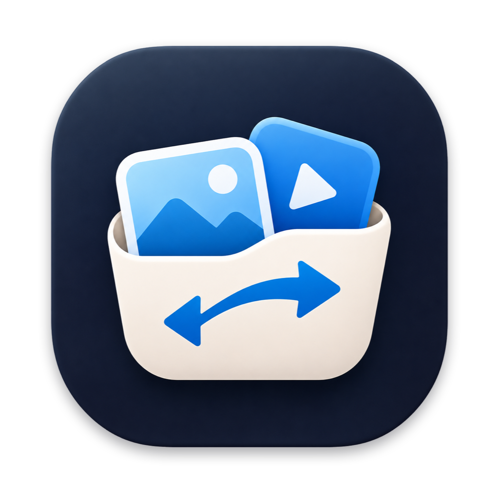
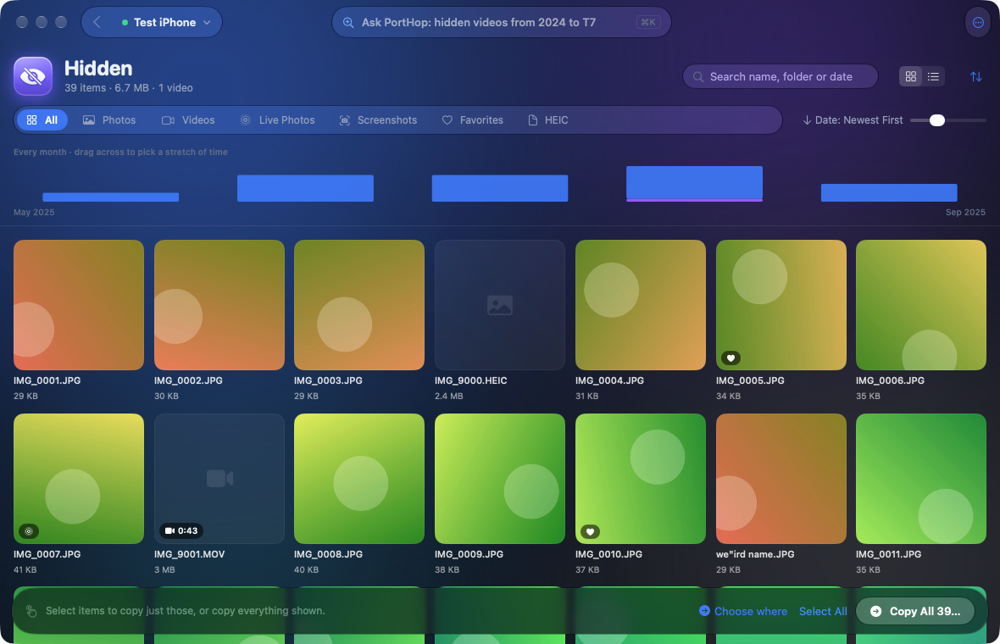
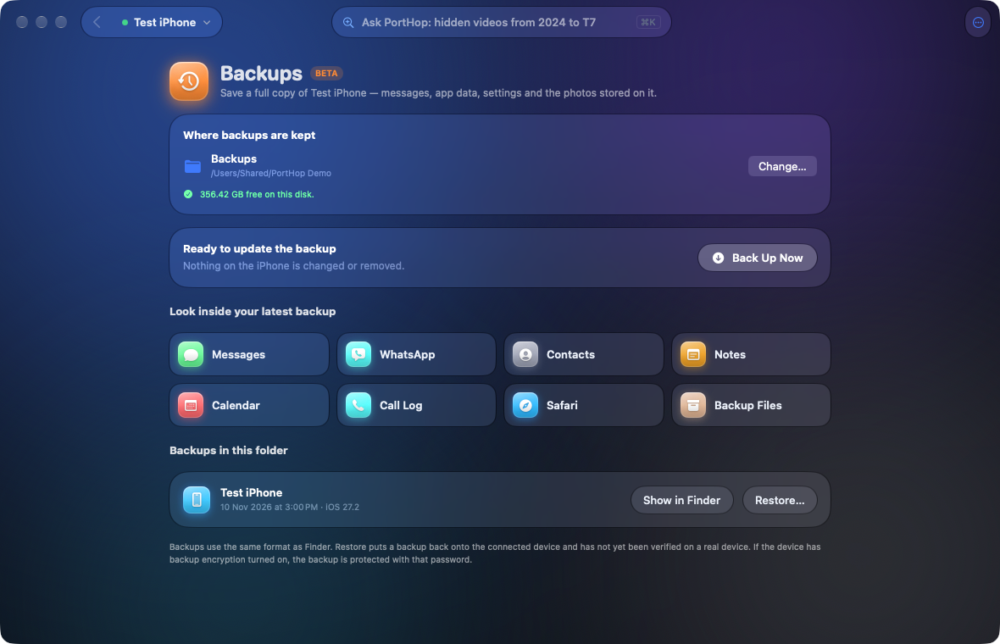
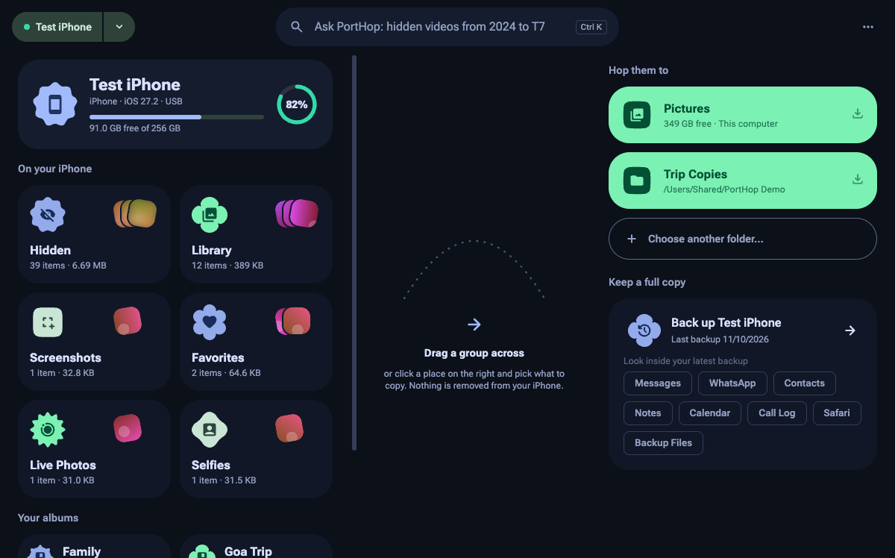

# PortHop

Copies photos, videos and files between an iPhone, iPad or Android device and a Mac (or a Windows PC, see `windows/`) over USB, to a folder or an external drive. Standalone: the device tools it needs are bundled inside the app.

Both apps follow the system's light or dark mode live, or can be fixed to either in the ⋯ menu (Appearance). On macOS 26 and later the Mac app uses Liquid Glass the way Apple's own apps do: the toolbar, buttons, the Ask panel and floating bars are glass, and content sits on quiet system surfaces. Older macOS versions get the same layout with solid surfaces. Its icons are Apple's own SF Symbols on light-catching tiles, with SF Symbols 7's gradient shading on macOS 26.

## Use it

1. Open **PortHop** (it is copied into Applications by `./build.sh --install`).
2. Plug in the iPhone, iPad or Android device, unlock it and tap **Trust** (**Allow** on Android). It appears by itself. With two devices plugged in, switch between them from the device menu at the top left.
3. **Shores** is the main screen: the device's photo groups on the left (Hidden, Library, Videos, Screenshots, your albums), places to copy them on the right (Pictures, each external drive, folders used before). Drag a group onto a place, or click a place and pick a group. The copy then hops across the middle.
4. Click a group to look inside: filter, search, drag across its month-by-month timeline to pick a stretch of time, select items, and copy just those.
5. Or type what you want into **Ask PortHop** at the top (⌘K), for example "hidden videos from 2024 over 100 MB to T7".

Copying again into the same folder is safe: files with the same name and exact size are recognised and skipped, and nothing is ever overwritten. The summary shows what was copied, what was already there and anything that couldn't be copied.

| | |
|---|---|
|  |  |
|  |  |

## Copy options

- **Edited versions:** turn on *Copy edited versions* to get photos and videos as edited in the Photos app (the edit iOS keeps on the device); anything without an edit comes out as the original.
- **iCloud-only items:** before copying, PortHop says how many items are stored only in iCloud ("Optimise Storage"), since those can't be copied over USB.
- **Folder patterns:** besides one folder, by month or by device folder, *Custom pattern* arranges copies with `{year} {month} {monthName} {day} {hour} {minute} {second} {album} {folder} {device} {kind} {name}`, e.g. `{album}/{year}/{month} {monthName}`.
- **File names:** *File names* renames the copies with the same tokens, e.g. `{year}-{month}-{day} {hour}.{minute}.{second}`, so photos from several phones sort by time and never clash. Shots taken in the same second get (2), (3)…
- **People:** people you have named in the Photos app (from its own face recognition) appear as groups under *People*, and Ask PortHop understands them: "videos of Mum from 2024 to T7".
- **Remove location:** *Remove location from the copies* wipes the GPS position from photos (JPEG, HEIC, DNG) and videos (MOV, MP4) as they land. It edits the metadata in place, so nothing is re-encoded and the picture and sound are untouched.
- **Copy report:** every copy writes `PortHop Reports/<date> <group>.csv` in the destination: what was copied (and its new name), what couldn't be and why (including items only in iCloud). Items already there are counted, not listed, so repeat hops stay small. Turn it off under *More options*.
- **One-click hops:** save a copy of a whole group to a folder as a hop. It shows on the home screen, and running it again copies only what's new.
- **Hops that run by themselves:** a saved hop can *Run by itself when this iPhone is plugged in*. It runs once each time that phone connects (never for another phone), copies only what's new and posts a notification when done.
- **HEIC to JPEG** works on both editions; on Windows it uses Microsoft's free *HEIF Image Extensions*.
- **Chats as web pages:** in Messages and WhatsApp, *Save as Web Page* writes the conversation as a page any browser opens, with the photos, videos and files that are in the backup copied next to it.
- **Android albums:** Android phones also show their photo folders from the phone's media index (Camera, Screenshots, WhatsApp Images…) with counts and sizes.

## External drives

Any drive the Mac can write to works (APFS, Mac OS Extended, exFAT, FAT32): pen drives, SSDs, hard disks. They show up as one-click destinations. FAT32 cannot hold files over 4 GB; the app warns before copying. NTFS drives are read-only on macOS and are shown as such.

## Device details

Click the device card on Shores, or open the device menu at the top left, for battery health and charge cycles, storage, device identifiers with Copy All, and Restart and Sleep. Screen transitions can be turned off in the settings menu (top right) or under View ▸ Animated Screen Transitions.

Hidden items appear only in **Hidden**, never in Screenshots, Favorites or other albums, matching the Photos app.

## Phone tools

The device menu (top left) and the device screen also open these:

- **Screen:** the phone's screen, live, with Screenshot and Record (saved in Pictures ▸ PortHop and Movies ▸ PortHop). An iPhone shows over USB the same way QuickTime Player shows it, with nothing installed on the iPhone (macOS asks once for camera permission, because it treats an iPhone's screen like a camera). An Android phone streams its screen through adb, and clicks and drags on the picture are sent to the phone as taps and swipes, with Back, Home and Recents buttons.
- **Apps:** the apps you installed, with their size and version; *Install App…* and *Remove…*. An iPhone installs `.ipa` files signed for that iPhone (your own builds, ad-hoc and company apps; App Store apps can't be installed this way). Android installs `.apk` files.
- **Music & Ringtones (iPhone):** songs synced from a computer or bought in the iTunes Store, and ringtones, copied into Artist ▸ Album folders, or sent straight to an Android phone plugged in at the same time. Apple Music downloads and songs that are only in the cloud are listed but not copied (they can't be played elsewhere). *Make a Ringtone…* turns up to 40 seconds of any song or sound file into an `.m4r` ringtone; Finder puts it on an iPhone, and on an Android phone it lands in Ringtones.
- **Spyware Check:** compares the phone with the spyware indicators that Amnesty International, Citizen Lab and others publish (the Mobile Verification Toolkit's public index, downloaded only when you click, or a `.stix2` file someone sends you). An iPhone is checked through its newest backup, so nothing on it is touched: Safari history, tabs and bookmarks, Messages and who sent them, WhatsApp, websites that apps loaded, which programs used the network, iMessage lookups, installed apps, configuration profiles and every file in the backup. An encrypted backup includes more. An Android phone is checked live: installed apps, programs running now, and which apps can read the screen, read notifications, administer the device or install other apps. Results save as a PDF. A match is a reason to get expert help (Amnesty's Security Lab, Access Now's helpline), not proof; no match is not a guarantee.
- **Phone report:** *Save Phone Report…* on the device screen makes a one-page PDF (model, storage, software, battery health and charge cycles), for a buyer or a repair shop. Whether parts are genuine is shown only on the iPhone itself (Settings ▸ General ▸ About ▸ Parts and Service History).

**An iPhone and an Android phone at once:** with both plugged in, the Android phone appears under *Hop them to* on Shores. Drop a group on it and the photos and videos go into the phone's DCIM ▸ PortHop ▸ <group> folder (HEIC converted to JPEG unless you untick it), where its Gallery and Google Photos find them. Items already there are skipped.

**Removing what was copied:** the copy sheet can *Remove from the iPhone after copying*. When the copy is done PortHop asks once more, then removes only items whose copy in the folder is complete, through the same camera route Image Capture uses, so the Photos library on the iPhone stays correct (Live Photos and edited items only when their video or edit was copied too; Hidden and iCloud-only items stay). After copying folders from an Android phone, *Remove from Phone…* does the same, file by file, only where the copy on the Mac has the same size.

These have been tested against simulated phones only, not yet on real devices.

## Sending files to the device

Shores lists apps that share a folder (for example video players and document readers) under "Send files to apps". Open one to drag files in from Finder, create folders, or copy its files back to the Mac. Files dropped from Finder onto the device's side of Shores go to an app of your choice. Existing files are never overwritten. Photos cannot be added to the Photos library this way; iOS does not allow it over this connection.

## Android (beta)

With an Android phone or tablet plugged in, the app shows its shared storage (Camera, Pictures, Download, Movies and the rest): copy files and folders to the Mac, drag files in from Finder, make folders. Nothing is overwritten in either direction. Overview shows battery, storage and device details, with Restart and Sleep.

Two things are needed:

- On the phone: turn on **USB debugging** (Settings ▸ About phone ▸ tap Build number seven times, then Settings ▸ Developer options ▸ USB debugging) and tap **Allow** when the Mac is first connected.
- On the Mac: Google's `adb`. Its licence does not allow it to be shipped inside another app, so *Set Up Android Support* downloads it from Google on request and checks Google's signature before using it (it lands in `~/Library/Application Support/PortHop/android/`). `brew install android-platform-tools` works too.

**Over Wi-Fi:** on Android 11 and later, *Connect an Android Phone over Wi-Fi…* pairs with the code from the phone's *Wireless debugging* screen (once), then connects; the phone then appears just like a plugged-in one.

Tested against a simulated phone only; not yet verified on a real Android device.

## Backups (beta)

**Backups** makes a standard full device backup (the format Finder uses) into a folder or external drive of your choice; later runs only copy changes. *Back up when plugged in, once a day* runs it by itself when the phone connects and has no backup from the last 20 hours (iOS asks for the passcode on the phone to start a backup). *Also back up over Wi-Fi, once a day* turns on the iPhone's own *Show this iPhone when on Wi-Fi* setting (while it's plugged in) and from then on, while PortHop is open, backs up an iPhone that was backed up here before whenever it's on the same Wi-Fi without the cable. *Keep earlier versions* keeps the previous backup as a dated snapshot before each new one: on APFS drives it is a clone, so it takes almost no extra space; the newest 7 are kept and can be restored like any backup. **Restore…** on a backup puts it back onto the connected device, replacing its settings and app data; it needs Find My turned off and asks for a typed confirmation first. Neither backup nor restore has been verified on a real device yet.

## Reading a backup (beta)

**From your backup** in the sidebar reads the newest backup in the backup folder without changing it: Messages and WhatsApp conversations, Contacts, Notes (the full text, decoded from Notes' compressed format; locked notes show their preview), Calendar, Safari bookmarks and history, Photos & Videos from the camera roll (useful when the phone itself is gone), Voice Memos, and every file in the backup (Backup Files), which can be copied out under its real name. Each list can be searched and saved as a spreadsheet (CSV) file; contacts also save as a vCard (.vcf) and calendars as an .ics file, which Contacts, Outlook, Gmail and Google Calendar import. Chats save as a web page, a paginated PDF, or every chat at once with an index page.

Password-protected (encrypted) backups are supported: the app asks for the backup password, uses it in memory only and never saves it. Decrypted working copies go to a temporary folder that is removed when the app quits. Apple only puts the call log in encrypted backups, so Call Log is empty for plain ones. Photos and attachments inside conversations are shown as a placeholder. Tested against a simulated backup with invented data only; not yet verified on a real one.

## What it does not do (yet)

- Live Photos export as the still image unless **Include Live Photo videos** is on.
- Originals stored only in iCloud are reported as not copied.
- Wi-Fi: phones on the same Wi-Fi can be included from the ⋯ menu (*Also find phones on Wi-Fi*). It is off by default because reading a whole library over Wi-Fi is much slower than USB.

## Windows edition

`windows/` holds a Windows edition with the same features and the same Shores layout, dressed in Material 3 Expressive: a colour scheme generated with Google's Material colour library, Google's Material Symbols icons in shape-morphing containers, a wavy progress bar and springy motion (an Electron app, so it can be built and tested from a Mac). See `windows/README.md`. It has been tested against simulated devices only, not yet on a real Windows PC.

## Command line

`porthop` drives the same engine from Terminal, for scripts and automation: `porthop devices`, `porthop groups`, `porthop copy <group> <folder> [--pattern …] [--names …] [--heic-to-jpeg] [--edited] [--live] [--no-location] [--json]`, `porthop backup <folder>`, `porthop music <folder>`, `porthop apps`, `porthop indicators [file.stix2]` and `porthop check <backup folder>` (or `porthop check` for a connected Android phone; exit code 1 when something matches). A copy run again copies only what's new, and the exit code says whether everything made it. On the Mac it lives at `PortHop.app/Contents/Helpers/porthop` (⋯ ▸ *Command-Line Tool…* shows how to link it into your path); on Windows it is `porthop.cmd` next to `PortHop.exe`.

## Updates

⋯ ▸ *Check for Updates…* asks GitHub for the latest PortHop release. When it is newer, *Install and Restart* downloads it, checks it against the publisher's Ed25519 signature (the public half of the key is built into the app, so a tampered or corrupted download is never installed), replaces the app and reopens it; *Release Page* opens the download page instead. By default PortHop checks by itself at most once a week; the request carries nothing about you or your devices, and ⋯ ▸ *Check for Updates Weekly* turns it off.

## iOS compatibility

The app reads the device's internal `PhotoData/Photos.sqlite`, which Apple does not document and can change in any release. The tables and columns are checked before use: optional ones degrade with a visible warning, and a missing required one stops with a clear message instead of wrong results. Verified on iOS 27.2 (iPhone 15 Pro Max).

## Build and test

- `./build.sh` builds and ad-hoc signs the app. Add `--install` to also copy it into Applications. It needs only Xcode (or its command-line tools): the iPhone tools inside the app are built from their official source by `build_tools.py` (about a minute the first time, cached afterwards).
- `Tests/run_tests.sh` runs the export engine against a simulated iPhone; no real device is touched.
- The environment variables used for automated UI checks only work in builds compiled with `-D UITEST`; normal builds ignore them.

Runs on Apple Silicon Macs with macOS 13 or later. Not notarized: on another Mac, right-click → Open the first time.

PortHop is released under the MIT licence (see `LICENSE`). The bundled open-source tools keep their own licences (GPL, LGPL, Apache); each app carries them, with a `SOURCES.txt` naming the exact source used.

## Signing, notarizing and the Windows installer

- `distribution/sign_and_notarize.sh` signs the Mac app with a Developer ID, sends it to Apple for notarization and staples the result, so it opens on any Mac without the "unidentified developer" warning. It needs a paid Apple Developer account; the script lists the one-time setup.
- `windows/installer/PortHop.iss` turns the Windows build into `PortHop-Setup.exe` (Start menu entry, uninstaller, no admin rights needed). Build it on Windows with the free Inno Setup 6.
- Neither has been run yet: they need an Apple Developer ID and a Windows PC.

## Working on the code

- `swift build` (or opening this folder in Xcode) builds and indexes the Mac app incrementally; `./build.sh` still makes the finished `PortHop.app`.
- `Tests/golden` holds test cases shared by both editions (Ask PortHop requests, folder and file-name patterns, update versions, and small JPEG/HEIC/MOV files for location removal); `Tests/run_tests.sh` and `windows/npm test` both run them, so the Mac and Windows code can't quietly drift apart.
- The Mac sources are split by job: `Models`, `Device`, `Catalog`, `Exporter`, `LocationScrubber`, `Thumbnails`, `Volumes`, `Backup`, `Ask`, `Updates`, `Spyware`, `ScreenStream`, `Music`, `Apps` and `Cleanup` for the engine, `Manager` plus `ManagerHops`, `ManagerDevice`, `ManagerFiles` and `ManagerTools` for app state, and one file per screen for the interface (`ToolsViews` holds the phone tools). `CLI/main.swift` is the command line. The Windows page is split the same way under `windows/renderer/` (`tools.js` for the phone tools, `h264.js` and `m4a.js` for the screen and ringtones), with `windows/tools-main.js` as its main-process side and `windows/cli.js` as its command line.
- `Helpers/applist.c` is PortHop's own small iPhone helper (MIT): the app list, installing and removing apps, and the Wi-Fi setting. Both `build_tools.py` and `windows/fetch-tools.py` compile it.

## Publishing a release

`python3 make_release.py` builds everything into `release/`: the Mac app, the Windows app (and its installer, when one was built on Windows), `PortHop-<version>-sources.zip`, and a `.sig` file for each app download. Upload them all to the same GitHub release: the apps install an update only when its signature matches. The signing key's private half is kept in `~/.porthop-release/update-signing-key.pem` (back it up; without it no update can be signed), the public half is `update-key.pub` in this folder, which the builds put into the apps; `python3 make_release.py --key-only` creates it. The GPL and LGPL licences of the bundled tools require their source to be offered from the same place as the apps, and the sources zip is that offer: PortHop's own code plus the exact source of every bundled tool and library.
